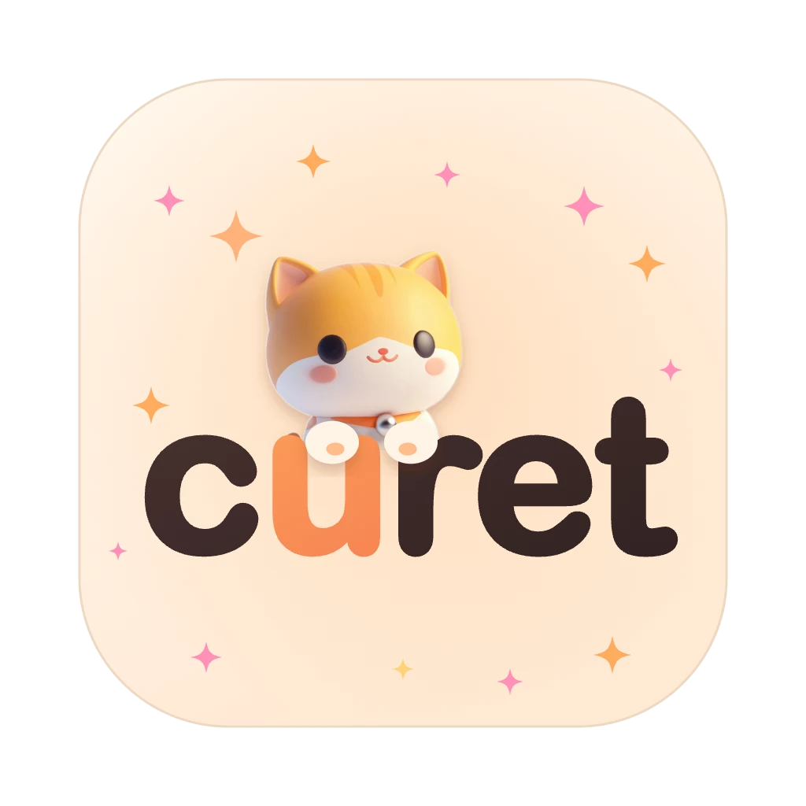

<p align="center">
  
</p>

<h1 align="center">Curet</h1>

<p align="center"><b>Organised enough to nag, kind enough to care.</b></p>

<p align="center">
A desktop pet that tracks your deadlines, books study time, nudges you back on track and reminds you to rest.
</p>

<p align="center">
  <a href="https://github.com/Ananya342/curet/releases">Download</a> ·
  <a href="#set-it-up">Set it up</a> ·
  <a href="#features">Features</a> ·
  <a href="#tech-stack">Tech stack</a>
</p>

---

## Features

**Deadlines, before they're due**
- Reads **Brightspace** and **Google Calendar**. Reminders arrive as speech bubbles 24 hours and 2 hours ahead, with a **Join** button for Meet, Zoom and Teams links.
- **Today** lists your classes, deadlines and exams, with the most pressing deadline first.
- A menu bar icon counts down to your next event. Click it for **Up next**, with buttons to tuck the pet in, chat, or plan.

**Syllabus in, semester planned**
- Upload a syllabus (PDF, photo or text). **Gemini** finds every exam, quiz and deadline. Tick the ones you want and they go on your Google Calendar.
- Press **Plan** on a deadline and the pet finds a free stretch before it's due and offers a study block: *Book it* or *Other time*.

**Focus, without the guilt**
- Focus sessions with a timer and the pet working alongside you.
- Notices when you drift (YouTube during a deadline, say) and offers *Lock in 25 min*, *5 more min* or *It's a break*. It only reads the site's domain, never the page, and you can turn it off.

**It looks after you, too**
- Morning and evening briefings, eye-rest breaks every 20 minutes (with a chime when it's time to look back), break reminders, and a late-night wind-down.
- **Week** shows focus time, deadlines met and tasks done, plus a short weekly reflection that stays on your computer.
- Its mood follows your week: happy when you're on top of things, worried when a lot is due.

**A pet that's yours**
- Seven pets: Boo, Mochi, Jelly, Ember, Maple, Perry and Biscuit.
- Dress them up with hats, caps, glasses, collars and a sparkly shine.
- Each one has its own voice (ElevenLabs) and reads its bubbles aloud if you switch voice on.
- Boop its nose, pet it, drag and toss it, or double-click for its menu. **⌥⌘L** tucks it away or wakes it up.

**Chat that knows your semester**
- Ask "What's due this week?" or "When am I free tomorrow?". The chat (Gemini) sees your deadlines, calendar, to-dos and focus history, and can add tasks or start a focus session for you.

## Download

**macOS:** grab the latest `Curet.app` from [Releases](https://github.com/Ananya342/curet/releases) and drag it into **Applications**.

The build isn't notarised yet, so the first time:
1. Right-click **Curet** in Applications and choose **Open**, then **Open** again.
2. If macOS says the app is damaged, run this once in Terminal:
   ```bash
   xattr -dr com.apple.quarantine /Applications/Curet.app
   ```

**Windows:** maintainers can build an installer from the **Actions** tab → **Windows build** → **Run workflow**. Some Mac-only extras (floating over full-screen apps, the drift check) aren't available there yet.

## Set it up

Open Curet's panel (click the pet, or the menu bar icon) → **Settings**.

1. **Connect Brightspace.** In Brightspace open *Calendar* → *Settings* (⚙) → tick **Enable Calendar Feeds** → *Subscribe* → choose **All Calendars and Tasks** → copy the link and paste it into **Brightspace deadlines**. (The Subscribe button stays hidden until feeds are enabled.)
2. **Connect Google Calendar.** Press **Sign in with Google** and pick your account. Curet can then see your calendar and add events, including syllabus dates and study blocks. Or, read-only: Google Calendar settings → your calendar → *Integrate calendar* → copy **Secret address in iCal format** and paste it under **Connected calendars**.
3. **Add a Gemini key** for chat and syllabus reading. Get one free at [aistudio.google.com/apikey](https://aistudio.google.com/apikey) and paste it under **Gemini**.
4. **Optional: voice.** Add an [ElevenLabs](https://elevenlabs.io/app/settings/api-keys) key under **Voice** and your pet reads its bubbles aloud.
5. **Pick your pet** in the **Pets** tab, and choose which nudges you want under **Daily rhythm**.

That's it. Curet wakes up with a morning briefing and takes it from there.

## Tech stack

| Layer | Built with |
|---|---|
| Desktop app | [Tauri 2](https://tauri.app) (Rust): floating pet and panel windows, menu bar icon, global shortcut, scheduler |
| Interface | React, TypeScript, Vite, Motion |
| Storage | SQLite (local) and the macOS Keychain for keys |
| AI | Google Gemini (chat with tool calling, syllabus reading) |
| Voice | ElevenLabs text-to-speech |
| Calendars | Google Calendar API (OAuth), iCal / Brightspace feeds |
| Website | HTML, CSS, JavaScript, GSAP, Lenis, Three.js, on Netlify |
| CI | GitHub Actions (Windows build) |

## Privacy

Your settings, calendar links, tasks, chat and journal live in a local SQLite file on your computer (`~/Library/Application Support/com.sid.lifepet/lifepet.db` on macOS). Nothing leaves it except calls to Google (calendar, Gemini), ElevenLabs if voice is on, and your own calendar feed URLs.

## Develop

```bash
npm install
npm run tauri dev           # run the app
npm run tauri build         # build Curet.app (src-tauri/target/release/bundle/macos)
cd src-tauri && cargo test  # calendar parser tests
```

Preview the views in a normal browser with a mocked backend: `npm run dev`, then open `http://localhost:1420/?mock#/pet` (or `#/panel`).

Debug switches: `LIFEPET_DOCK=1` keeps a Dock icon (handy for automation tools). `LIFEPET_DEBUG=/path/to/cmdfile` logs window geometry to stderr and polls that file for `dump` / `emit <window> <event> [json]` commands.

### Maintainers: Google sign-in (once)

Curet ships one OAuth client; every user signs in with their own account.

1. In [Google Cloud Console](https://console.cloud.google.com/) create a project and enable the **Google Calendar API**.
2. Google Auth Platform → configure the consent screen (External), add scopes `calendar.events`, `calendar.calendarlist.readonly`, `openid`, `email`, and a privacy-policy URL.
3. Clients → **Create client** → type **Desktop app**.
4. Put the client in `.env.local` (copy `.env.example`; it's gitignored) or pass it on the command line, then build:
   ```bash
   LIFEPET_GOOGLE_CLIENT_ID=xxx.apps.googleusercontent.com LIFEPET_GOOGLE_CLIENT_SECRET=xxx npm run tauri build
   ```
   Google doesn't treat a desktop app's client secret as confidential. Without these, the sign-in button is disabled.
5. While the consent screen is in *Testing*, only listed test users can sign in and tokens expire after 7 days. Publish it and complete Google's verification (free; calendar access is a sensitive scope) to open sign-in to everyone.

Pet art: cut-out renders in `public/pets/` (made with `scripts/cutout.swift`, which uses macOS Vision).
